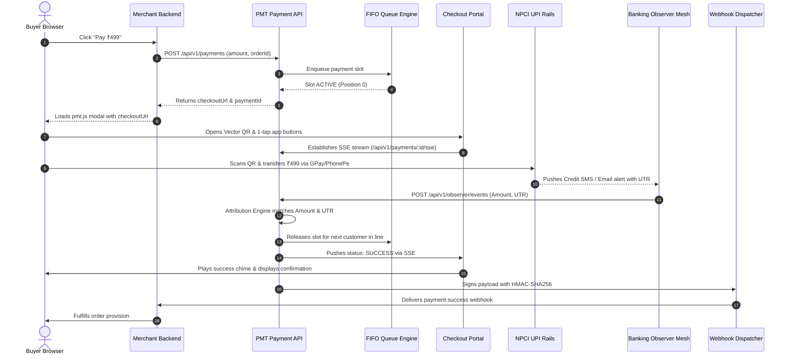

# PMT GTW (ONLINE) — System Architecture & Design Specification

## Overview

PMT GTW (Online) is a high-throughput, sovereign, self-hosted UPI Payment Gateway designed to operate with zero aggregator transaction fees, direct bank account settlements, and multi-channel automated banking observation.

---

## 1. Monorepo Structure

```
pmt-gtw-online/
├── apps/
│   ├── payment-api/         # Core Payment REST API & SSE Broadcast Engine (Port 6100)
│   ├── checkout-portal/     # High-conversion Vector SVG QR Customer Checkout (Port 7000)
│   ├── merchant-admin/      # Merchant Portal, Transactions Ledger & POS Till Dock (Port 6001)
│   ├── demo-store/          # Cloud Showcase Storefront with 1-Click Checkout (Port 5000)
│   └── control-center/      # Process Supervisor & Network Health Dashboard (Port 8090)
├── packages/
│   ├── common/              # Crypto primitives (HMAC-SHA256), timing-safe comparisons, UPI builders
│   ├── db/                  # SQLite WAL Native DatabaseSync client, repositories, and migrations
│   ├── core/                # Attribution Engine, 18+ Bank SMS/Email parsers, FIFO Queue, Timers
│   ├── merchant-sdk/        # Universal drop-in pmt.js client script & Node.js Merchant Client SDK
│   └── observer-sdk/        # Client SDK for Android APK and headless banking observers
└── scripts/
    ├── dev.js               # Multi-service local supervisor runner
    ├── start.js             # Production launcher
    ├── seed.js              # Database bootstrap seeder
    └── test-all.js          # Full regression test suite
```

---

## 2. Core Operational Flow



---

## 3. Data Integrity & Concurrency

### SQLite Native WAL Mode
PMT GTW utilizes Node.js 20+ native `node:sqlite` `DatabaseSync` engine configured with:
- `PRAGMA journal_mode = WAL;` (Write-Ahead Logging enables simultaneous readers without blocking writers)
- `PRAGMA busy_timeout = 10000;` (Prevents database lock contention under heavy concurrency)
- `PRAGMA synchronous = NORMAL;`
- `PRAGMA foreign_keys = ON;` (Strict relational referential integrity)

### Deterministic FIFO Concurrency Queue
Since standard personal and business UPI credit notifications do not contain merchant-controlled payload headers, multiple concurrent payments with the exact same amount could lead to attribution ambiguity. PMT GTW enforces an invariant single-slot FIFO queue per VPA:
1. Only **one** customer pays on a specific VPA at any given second.
2. Concurrent buyers enter a database-backed FIFO queue with real-time position streaming (`WAITING`, `position: 1`).
3. When the active buyer completes or cancels, the next buyer is automatically promoted to `ACTIVE` and their vector QR is generated.

---

## 4. Security Model

1. **HMAC-SHA256 Signed Outbound Webhooks**: Every webhook includes `X-PMT-Signature` generated using the merchant's secret key, validated using timing-safe comparisons (`crypto.timingSafeEqual`).
2. **Mutual Observer Authentication**: Observer devices (Android APK, Gmail CDP, SMS CDP) register with an HMAC device key and sign every telemetry event.
3. **Anti-Replay Protection**: The Attribution Engine checks each incoming UTR against historical records. Replayed or duplicate UTRs are marked `DUPLICATE` and discarded immediately.
4. **Rate Limiting**: Sliding window rate limiters protect OTP and order creation routes.
