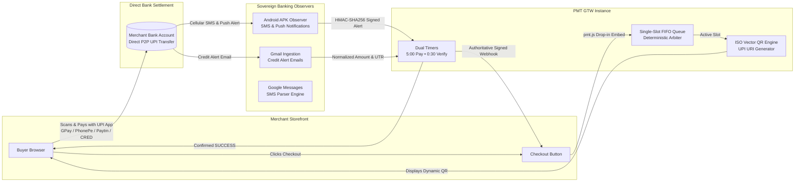

<div align="center">

```
██████╗ ███╗   ███╗████████╗     ██████╗ ████████╗██╗    ██╗
██╔══██╗████╗ ████║╚══██╔══╝    ██╔════╝ ╚══██╔══╝██║    ██║
██████╔╝██╔████╔██║   ██║       ██║  ███╗   ██║   ██║ █╗ ██║
██╔═══╝ ██║╚██╔╝██║   ██║       ██║   ██║   ██║   ██║███╗██║
██║     ██║ ╚═╝ ██║   ██║       ╚██████╔╝   ██║   ╚███╔███╔╝
╚═╝     ╚═╝     ╚═╝   ╚═╝        ╚═════╝    ╚═╝    ╚══╝╚══╝ 
```

# PMT GTW (ONLINE)

### Next-Gen Self-Hosted White-Label UPI Payment Gateway & Banking Observation Engine

**Created & Maintained by [Shubh Gupta](https://github.com/shubhG-9401)**  
*0% Aggregator Fees • Direct P2P Bank Settlement • Vector SVG QR • Multi-Channel Banking Observation Mesh*

<br/>

[](https://nodejs.org)
[](#)
[](#)
[](#)
[-success?style=for-the-badge&logo=vitest&logoColor=white)](#)
[](LICENSE)
[](#)

<br/>

<p align="center">
  <a href="#-features--superpowers">Superpowers</a> •
  <a href="#-architecture">Architecture</a> •
  <a href="#-quickstart-in-60-seconds">Quickstart</a> •
  <a href="#-port-topology">Port Topology</a> •
  <a href="#-merchant-sdk-integration">Merchant Integration</a> •
  <a href="#-banking-observation-mesh">Banking Observers</a> •
  <a href="#-license">License</a>
</p>

---

</div>

<br/>

## 🎯 Overview

Traditional payment gateways (Razorpay, Cashfree, PayU, Stripe) lock your business into high transaction commissions (2.0% - 3.0% + GST), delayed T+2 settlements, compliance freezes, and non-negotiable branding:

| Comparison Metric | Traditional Aggregators (Razorpay / Cashfree) | **PMT GTW (Self-Hosted Sovereign)** |
| :--- | :--- | :--- |
| **Transaction Fee** | **2.0% – 3.0% + 18% GST** per transaction | **0.0% (Zero Fees Forever)** |
| **Settlement Speed** | **T+2 to T+3 Business Days** (Holdbacks) | **Instant (Direct into your Bank Account)** |
| **Account Freeze Risk** | **High** (Unilateral freezes at aggregator discretion) | **ZERO** (You control your own VPA & server) |
| **Payment Verification** | Aggregator proprietary webhooks | **Bank SMS & Email Ingestion** in real-time |
| **Branding Control** | "Secured by Razorpay" badges mandatory | **100% White-Label** (Your brand, your domain) |
| **Offline Retail Till** | Expensive POS machines & monthly rentals | **Built-in POS Cash & Card Till Billing Dock** |
| **Database Requirement**| Heavy external SQL server clusters | **Embedded Node.js native `node:sqlite` WAL** |

<br/>

---

## 🏛️ Architecture

PMT GTW utilizes standard Indian personal or business UPI receiving accounts for payment collection by coupling **pure vector SVG QR codes** with an **automated multi-channel banking observation mesh**.



<br/>

---

## ✨ Key Features & Superpowers

### 1. 0% Commission Fees (Self-Hosted Sovereign)
Every rupee paid goes straight from your customer's bank account to your bank account via NPCI UPI rails. No intermediaries hold your revenue.

### 2. High-Precision Banking Observation Mesh
Supports real-time parsing of incoming banking alerts across 18+ major Indian banks:
- **State Bank of India (SBI), HDFC Bank, ICICI Bank, Axis Bank, Kotak Mahindra Bank**
- **Punjab National Bank (PNB), Bank of Baroda (BOB), Canara Bank, IndusInd, IDFC FIRST, Yes Bank**
- Extracts: Credit Amount, 12-digit UTR/RRN, Bank Identifier, Payer VPA / Name.

### 3. Pure Vector SVG QR Code Engine
Generates mathematical vector SVG QR codes with zero raster compression artifacts. Renders sharply on high-DPI retina displays, mobile screens, and printed till receipts.

### 4. 1-Tap Mobile UPI App Deep-Linking
One-tap launch buttons for all major UPI payment apps on mobile:
- **Google Pay** (`tez://upi/pay`)
- **PhonePe** (`phonepe://pay`)
- **Paytm** (`paytmmp://pay`)
- **CRED** (`credpay://upi/pay`)
- **BHIM** (`bhim://pay`)
- **Amazon Pay** (`amazonpay://upi/pay`)

### 5. Deterministic Single-Slot FIFO Concurrency Queue
Ensures zero transaction attribution ambiguity when multiple customers pay identical amounts simultaneously.

### 6. Retail POS Till Counter Billing Mode
Walk-in retail storefront billing mode with 1-click Cash at Till (`CASH`) or Card at POS Terminal (`CARD`) approval with instant SSE push to customer.

### 7. Universal 1-Line Drop-in Client Script (`pmt.js`)
Integrate into any website, HTML page, Shopify, or custom frontend with just a single `<script>` tag. Auto-binds to `[data-pmt-pay]` buttons or via JavaScript API `PmtGateway.open({ ... })`.

<br/>

---

## 🚀 Quickstart in 60 Seconds

### Prerequisites
- **Node.js `>= 20.0.0` LTS** (`node -v`)
- Windows, Linux, or macOS host
- *Zero external database or Docker services required!*

### 1. Clone & Install
```bash
git clone https://github.com/shubhG-9401/pmt-gtw-online.git
cd pmt-gtw-online
npm install
```

### 2. Launch All Microservices
```bash
# On Windows:
start.bat
# or npm run dev

# On Linux / macOS:
chmod +x start.sh && ./start.sh
# or npm run dev
```

### 3. Run the Regression Test Suite
Verify all 12 test suites:
```bash
npm test
```

<br/>

---

## 🌐 Port Topology

| Service | Port | Local URL | Description |
| :--- | :--- | :--- | :--- |
| **Control Center** | `8090` | [`http://localhost:8090`](http://localhost:8090) | Process supervisor & network health hub |
| **Customer Checkout**| `7000` | [`http://localhost:7000`](http://localhost:7000) | Responsive Vector QR customer checkout portal |
| **Merchant Admin** | `6001` | [`http://localhost:6001`](http://localhost:6001) | Transactions ledger, analytics & POS till dock |
| **Payment REST API**| `6100` | [`http://localhost:6100`](http://localhost:6100) | Central payment engine & real-time SSE stream |
| **Cloud Demo Store** | `5000` | [`http://localhost:5000`](http://localhost:5000) | Showcase cloud store with 1-click checkout |

<br/>

---

## 💻 Merchant SDK Integration

### 1. Universal Drop-in Client (`pmt.js`)
Add the script to your HTML `<head>`:
```html
<script src="http://localhost:7000/pmt.js"></script>

<!-- Add data-pmt-pay attribute to any button -->
<button data-pmt-pay data-checkout-url="http://localhost:7000/checkout/pmt_9f82b71e">
  Pay ₹499 with UPI
</button>
```

Or trigger programmatically via JavaScript:
```javascript
window.PmtGateway.open({
  checkoutUrl: 'http://localhost:7000/checkout/pmt_9f82b71e',
  onSuccess: (payment) => {
    console.log('Payment successful! UTR:', payment.utr);
    alert('Thank you! Order confirmed.');
  },
  onFailure: (err) => {
    console.error('Payment failed:', err);
  }
});
```

### 2. Backend Order Creation (Node.js SDK)
```javascript
import { PmtMerchantClient } from '@pmt/merchant-sdk';

const pmt = new PmtMerchantClient({
  apiKey: 'pmt_live_sec_99a8b7c6d5e4f3a2b1c0d9e8f7a6b5c4',
  webhookSecret: 'pmt_whsec_77b6c5d4e3f2a1b0c9d8e7f6a5b4c3d2',
  baseUrl: 'http://localhost:6100'
});

// Create payment session
const session = await pmt.createPayment({
  amount: 499.00,
  orderId: 'ORD_1001',
  customerMobile: '9876543210'
});

console.log('Checkout URL:', session.payment.checkoutUrl);
```

### 3. Authoritative Webhook Verification
```javascript
// Inside your Express/Fastify/Node.js webhook handler
app.post('/api/webhook', (req, res) => {
  const signature = req.headers['x-pmt-signature'];
  const timestamp = req.headers['x-pmt-timestamp'];

  const isValid = pmt.verifyWebhook(req.rawBody, signature, timestamp);
  if (!isValid) {
    return res.status(401).send('Invalid signature');
  }

  const event = req.body;
  if (event.event === 'payment.success') {
    console.log(`Order ${event.data.orderId} verified with UTR ${event.data.utr}`);
    // Fulfill order
  }

  res.json({ received: true });
});
```

<br/>

---

## 📡 Banking Observation Mesh

PMT GTW includes endpoints and client libraries for connecting automated observer channels:

```bash
# Push an observed bank SMS or push notification:
curl -X POST http://localhost:6100/api/v1/observer/events \
  -H "Content-Type: application/json" \
  -d '{
    "observerType": "ANDROID_SMS",
    "rawPayload": "Dear Customer, Rs 499.00 credited with a/c **9876 on 19-10-2026. Ref UTR: 123456789012.",
    "sender": "HDFCBK"
  }'
```

The **Attribution Engine** automatically parses the amount (`499.00`) and 12-digit UTR (`123456789012`), attributes it to the corresponding pending session, marks the order `SUCCESS`, fires real-time SSE updates, and dispatches signed webhooks.

<br/>

---

## 📄 License

This project is licensed under the **MIT License** — see the [LICENSE](LICENSE) file for details.  
Maintained by **[Shubh Gupta](https://github.com/shubhG-9401)**.
